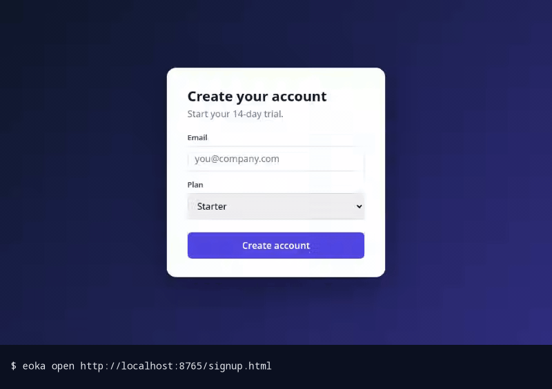
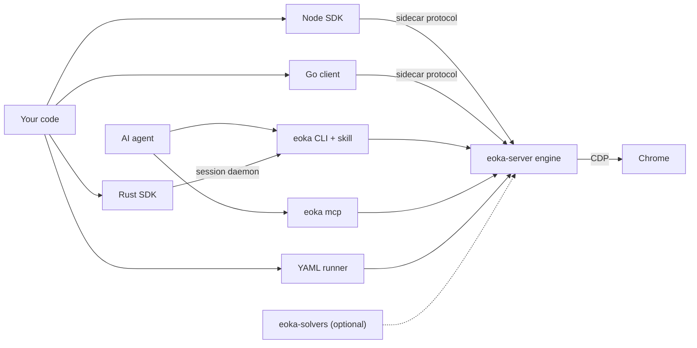

# eoka-tools

[](https://github.com/shrimp-software/eoka-tools/actions/workflows/ci.yml)
[](https://crates.io/crates/eoka-cli)
[](https://www.npmjs.com/package/@cbxss/eoka)
[](https://pkg.go.dev/github.com/shrimp-software/eoka-tools/clients/go)
[](LICENSE)

Browser automation for AI agents, built on [eoka](https://github.com/shrimp-software/eoka), a low-level CDP library for real Chrome.

One shared engine drives every interface: a CLI with an agent skill, an MCP server, Node, Go and Rust SDKs, and a YAML runner. Actions are verified and durable. Each one gets an operation ID, waits for its expected outcome, and survives a lost response.





## Install

```sh
curl -fsSL https://raw.githubusercontent.com/shrimp-software/eoka-tools/main/crates/eoka-cli/scripts/install.sh | sh
eoka skill install
```

The script installs the latest `eoka` release for Linux or macOS and verifies it against the release `SHA256SUMS`. `eoka skill install` writes the agent skill for Claude Code, Codex and other agents. `eoka update` keeps both current. From source: `cargo install eoka-cli`.

## Quick start

**CLI**, for agents and interactive use:

```sh
eoka --session demo open https://example.com
eoka --session demo view
eoka --session demo step '{"action":{"kind":"hover","target":"REFERENCE_FROM_VIEW"}}'
```

**MCP**, with the CLI installed as above:

```sh
claude mcp add eoka -- eoka mcp
```

**Node / TypeScript** (`npm install @cbxss/eoka`):

```js
import { Browser } from "@cbxss/eoka";

await using browser = await Browser.launch();
const page = await browser.newPage("https://example.com");
console.log(await page.title());
```

**Go:** `go get github.com/shrimp-software/eoka-tools/clients/go`. See the [Go client](clients/go/README.md).

**Rust:**

```rust
use eoka_server::{Session, eoka::{ActionOptions, Expectation}};

let mut session = Session::launch().await?;
session.goto("https://example.com").await?;
session.observe().await?;
session.set_action_options(ActionOptions::expecting(Expectation::Url {
    value: "https://www.iana.org/help/example-domains".into(),
    contains: false,
}));
session.click(0).await?;
session.close().await?;
```

**YAML runner** (`cargo install eoka-runner`, then `eoka-runner automation.yaml`):

```yaml
name: Example
target:
  url: https://example.com
actions:
  - click:
      text: More information
      expect:
        kind: url
        value: https://www.iana.org/help/example-domains
```

## Components

| Component | Purpose |
|---|---|
| [**eoka-mcp**](crates/eoka-mcp) | MCP server for browser tools, run as `eoka mcp` |
| [**eoka-cli**](crates/eoka-cli) | Interactive shell CLI for browser automation and debugging |
| [**eoka-server**](crates/eoka-server) | Shared browser runtime, `Session` API, and browser helper primitives |
| [**eoka-protocol**](crates/eoka-protocol) | Shared daemon protocol types and tool catalog metadata |
| [**eoka-sdk**](crates/eoka-sdk) | Rust SDK for typed Eoka browser sessions |
| [**eoka-tack**](crates/eoka-tack) | Tack `ToolSet` adapter generated from the Eoka protocol catalog |
| [**@cbxss/eoka**](clients/node) | Node/TypeScript SDK for private sidecar sessions: `npm install @cbxss/eoka` |
| [**eoka-runner**](crates/eoka-runner) | Declarative YAML automation runner |
| [**eoka-solvers**](crates/eoka-solvers) | Optional CAPTCHA plugins: Anti-Captcha provider and local DataDome slider |
| [**eoka-email**](crates/eoka-email) | IMAP helpers for OTP and verification-link flows |

## Plugins

CAPTCHA solving and Tack scripting are cargo features. The released binaries include all of them; leave them out for a smaller build:

| Feature | Adds | Crates |
|---|---|---|
| `anti-captcha` | `eoka captcha solve`, MCP `solve_captcha`, sidecar `page.solve_captcha` | eoka-cli, eoka-mcp, eoka-server |
| `datadome` | `eoka captcha datadome`, `captcha.datadome` | eoka-cli, eoka-mcp, eoka-server |
| `tack` | `eoka tack` | eoka-cli |

```sh
cargo install eoka-cli --no-default-features
cargo install eoka-cli --no-default-features --features datadome
```

A build without a plugin leaves its operations out of `server.hello`, the MCP tool list and `eoka tools manifest`, and answers `feature_unavailable` if one is called anyway. Turnstile clicking, CAPTCHA detection and token injection need no extra crates and are always built in.

## Documentation

- [Agent browsing](docs/agent-browsing.md): the `view` / `step` loop, references and blocked tabs
- [Durable operations](docs/operations.md): operation IDs, expectations and recovery
- [CLI guide](docs/cli.md): frames, held input, DataDome, page evidence and safety defaults
- [Downloads and fetch](docs/downloads.md)
- [Sidecar protocol](docs/protocol.md)
- [Development](docs/development.md)
- Per-component guides: [CLI skill](crates/eoka-cli/skill/SKILL.md), [MCP](crates/eoka-mcp/README.md), [Node](clients/node/README.md), [Go](clients/go/README.md), [runner](crates/eoka-runner/README.md)

## License

MIT
